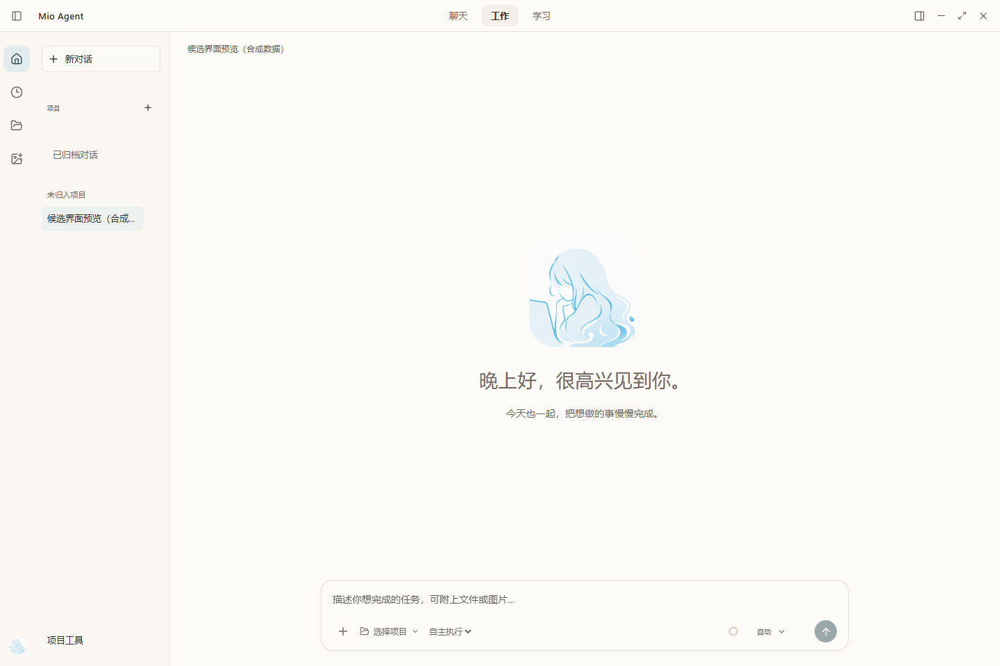
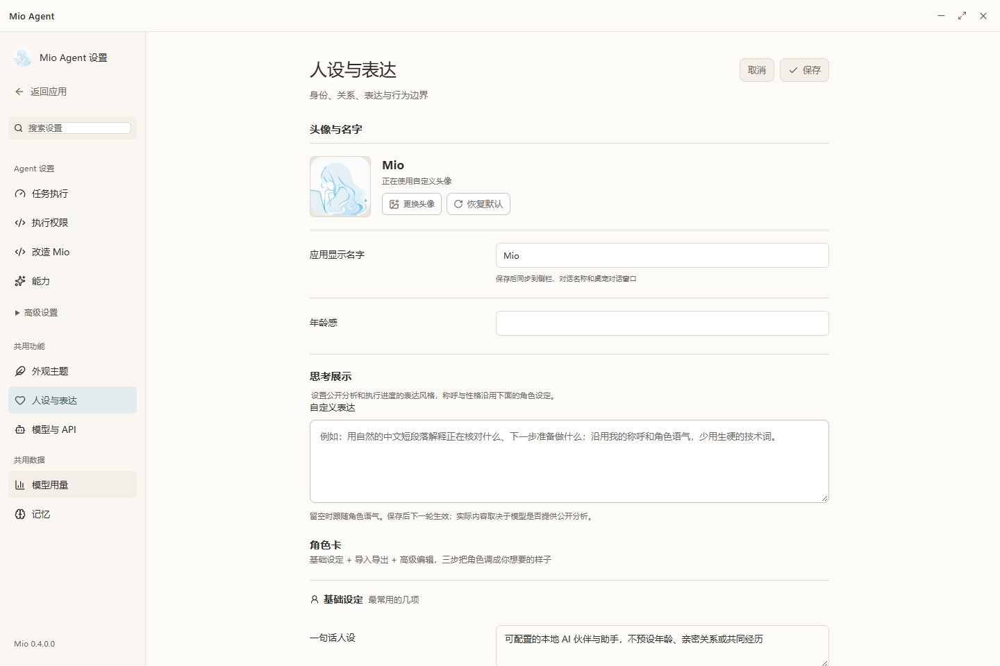

<p align="center">
  
</p>

<h1 align="center">Mio · 澪</h1>

<p align="center">
  Windows 上的个人 AI 伙伴与 Agent
</p>

<p align="center">
  <strong>中文</strong> · <a href="README_EN.md">English</a> ·
  <a href="https://github.com/ochiru520/Mio/releases/tag/v0.4.0">下载 0.4.0</a> ·
  <a href="https://github.com/ochiru520/Mio/issues">反馈问题</a>
</p>

<p align="center"><strong>0.4.0 · Windows x64 · MIT</strong></p>

Mio 把日常对话、长期记忆、日记、语音和 Live2D 桌宠放在一起，也提供处理资料、文件和代码的 Agent 工作空间。你可以和她聊天、回顾生活，或在授权后让她协助工作、学习和创作。聊天与 Agent 共享本地数据、模型供应商、主题和人设。

## ✨ 速览

- **对话与陪伴**：多会话、多模型供应商、附件、思考档位，以及可选的 Live2D 桌宠和语音互动。
- **记忆与日记**：查看记忆来源、编辑与确认、处理冲突、恢复历史版本；整理每日回顾、周记、月记并导出 Markdown。
- **工作、学习与生图**：用自然语言发起任务，查看进展、补充要求、停止或恢复；创作入口连接你配置的生成服务或 ComfyUI 工作流。
- **项目与成果**：绑定项目目录，归档会话、资料、任务和成果，保留来源与版本，在侧栏查看图片及 Office 内容。
- **代码与电脑操作**：在授权范围内读写代码、查看差异、运行检查与终端命令，观察和操作已授权的 Windows 窗口。
- **能力与本地改造**：版本化技能、受限的数据处理工具与面板；具备匹配源码和开发依赖时，可以构建、预览并确认应用 Mio 改造候选。
- **本地数据与可选接入**：SQLite、完整备份恢复、环境组件管理；按需配置微信、QQ、屏幕与系统声音观察。

## 🚀 快速开始

### 安装 0.4.0

从 [0.4.0 发布页](https://github.com/ochiru520/Mio/releases/tag/v0.4.0) 下载 `Mio-0.4.0-Windows-x64-Setup.exe` 和对应 SHA-256 文件，核对校验值后安装。主程序包含运行环境，普通用户无需自行安装 Python 或 Node.js。

Windows 11 x64 是主要验证环境，桌面主窗口需要 [WebView2 Runtime](https://developer.microsoft.com/microsoft-edge/webview2/)。安装包没有 Windows 代码签名，请从上述发布页获取并核对校验文件。

### 第一次使用

1. 在首次向导中确认环境、名字与称呼，添加模型供应商。也可以先跳过，稍后到“设置 > 模型与 API”填写 API Key、服务地址与模型。
2. 先试一次对话，再进入 Agent 的“工作”“学习”或“生图”。在“项目”绑定已有目录或创建新目录。
3. 到 Agent“设置 > 执行权限”确认文件、终端和窗口授权，按实际任务选择权限档位。
4. 聊天“设置 > 环境与模型”管理可选组件，“设置 > 数据与隐私”建立完整备份。云端服务需要你自己的 API，启用前请确认供应商价格。

模型权重、Genie 运行数据、Mio 音色、QQ/NapCat、自定义角色资产和参考音频不随主安装包提供。

## 🖼️ 功能与界面

以下截图来自独立示例环境，展示自定义头像效果；头像、人设与主题可在设置中调整。

### Agent：从任务到成果

<p align="center">
  
</p>

工作、学习和生图入口围绕项目目录展开：会话、资料、任务与成果可以一起管理，生成的文件和图片可在右侧查看。任务进行中可以补充要求、停止或恢复。

0.4.0 为长任务保存持久摘要，并保留完整历史回读和上下文估算。断线后会核对原请求，未知的写入结果不会自动重做；摘要仍可能遗漏细节。

Office 侧栏预览支持的文字、表格和图片，不完整还原原始排版、图表或动画，也不重算 Excel 公式。大文件、损坏及不支持的文件会给出说明。

### 对话、记忆与生活记录

对话支持 Responses / Chat Completions、多供应商、附件和 Token 与费用记录。记忆可以查看来源、人工编辑和确认，处理冲突、停用或恢复历史版本。日记包含每日回顾、周记、月记和成长统计；月记显示完整月份与来源日记，记录可导出 Markdown。

可选 Live2D 桌宠以独立窗口运行，提供动作与表情；语音使用 Genie 本地音色、faster-whisper 转写及语音互动。微信和 QQ 需要配置相应接入，QQ 使用 NapCat / OneBot；主动联系、自动记录、联网和观察分别配置。

### 设置：模型、环境与权限

<p align="center">
  
</p>

模型供应商、主题和人设在聊天与 Agent 间共享，各自专属设置分别保留。环境中心可检查、安装、验证和卸载受管可选组件；卸载前显示范围，外部复用资源在原位置管理。更新支持签名清单、迁移检查和确认安装。

已安装、已配置、已连接与通过真实调用是不同状态，请以界面实际检测结果为准。

### 扩展能力与改造 Mio

技能与受限扩展支持验证、版本管理、启用和回退。改造 Mio 需要对应版本的源码及开发依赖，在独立副本中检查、构建和预览候选，默认由你确认后应用。安装失败或中断有回退处理；主动回退仍受版本与数据兼容性限制。

## 🔐 权限、隐私与费用

“只查看”“帮我做事”“自主执行”均受实际授权约束，自主执行不会扩大权限。本机终端没有系统沙箱；可选隔离终端需要 Docker，不可用时拒绝运行。Windows 操作依赖软件界面、焦点、授权及组件环境，无法保证操作所有软件。

数据保存在你选择的本机目录，升级沿用原目录。模型密钥通过 Windows DPAPI 加密，仅对当前 Windows 用户有效；完整备份不等于跨机器自动恢复密钥。

使用云端模型、搜索或云端视觉时，请求所需内容会发送给你选择的服务，本地优先不代表全部离线。屏幕、系统声音、QQ 和主动行为可单独关闭，也可通过隐私总控暂停。更新检查读取发布服务；费用展示依赖供应商提供的信息，不能替代供应商账单。

公开仓库不包含作者的聊天、日记、私人角色设定、API Key、QQ 登录态、训练音频或私人模型。

## 📦 可选组件与兼容性

**Genie 与 Mio 音色是独立可选数据包。** 环境中心提供获取与安装说明、HTTPS 下载源配置和离线包选择，并在安装前校验包内容。目前不能承诺可用的官方默认下载源；获取入口不代表已经提供对应附件。在线安装需要真实可用且匹配的来源，离线安装需要先取得对应包。可获取与可分发范围以实际公开附件及各自许可为准。

相关功能已进行自动检查、隔离样例与界面验证，但兼容性仍取决于显卡、声卡、模型供应商和本机环境。QQ、微信及创作、生图、视频功能需用户在自己的环境中自测；语音与桌宠尚未重新完成本次版本的实际运行验证。完整的干净 Windows 首次安装验证也尚未完成。

## 🧱 技术栈与项目结构

| 部分 | 技术 |
|---|---|
| 界面 | Vue 3、Vite、JavaScript |
| 后端与数据 | Python 3.10、FastAPI、SQLite |
| Windows 桌面 | Windows 启动器、WebView2、独立 Live2D 窗口 |
| 可选语音与创作 | Genie、faster-whisper、生成服务 / ComfyUI 工作流 |

```text
Mio/
├─ 私人AI日记系统/   后端、记忆、记录与服务
├─ 澪Agent应用/      界面、Windows 启动器、更新器与 Live2D
├─ docs/image/       项目标识与软件截图
├─ README.md
└─ README_EN.md
```

中文子目录名称保留用于构建与路径兼容。公开版本与私人开发版本使用不同通道，不按版本数字大小跨通道升级。

## 🛠️ 从源码运行

开发环境：Windows x64、Python 3.10（发布构建使用 3.10.11）、Node.js 22.12+。源码 ZIP 不需要 Git，构建安装器另需 Inno Setup 6。

先构建界面：

```powershell
cd .\澪Agent应用
npm ci
npm run build
```

再启动后端：

```powershell
cd ..\私人AI日记系统\backend
py -3.10 -m venv .venv
.\.venv\Scripts\python.exe -m pip install -r requirements.txt
Copy-Item .env.example .env
.\.venv\Scripts\python.exe -m uvicorn app.main:app --host 127.0.0.1 --port 8000
```

打开 `http://127.0.0.1:8000/agent-app/`。开发时可在界面目录运行 `npm run dev`；完整 Windows 构建使用 `构建Windows应用.ps1`。后端只应监听本机，不要直接暴露到公网。Windows CI 与检查命令见 [CONTRIBUTING](CONTRIBUTING.md)。

## 📖 帮助与许可

- [使用与升级指南](私人AI日记系统/文档/使用与升级指南.md) · [0.4.0 更新记录](CHANGELOG.md)
- [隐私说明](私人AI日记系统/文档/隐私说明.md) · [安全说明](SECURITY.md)
- [资产与第三方许可](私人AI日记系统/文档/资产与第三方许可.md) · [参与贡献](CONTRIBUTING.md)
- [反馈问题](https://github.com/ochiru520/Mio/issues)：请附脱敏诊断与复现步骤，不要上传数据库、密钥或私人对话。

原创代码和文档采用 [MIT](LICENSE)。Live2D、模型权重、音色、角色图片及用户导入资产遵循各自许可。
